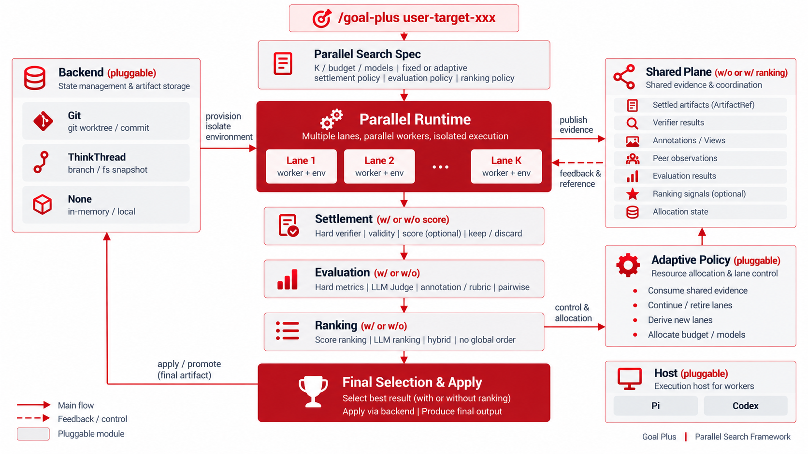

<!-- markdownlint-configure-file {"MD033":{"allowed_elements":["details","summary","div","b"]},"MD013":false,"MD041":false} -->

English | [简体中文](README_zh.md)

<div align="center">

# Goal Plus

**Concurrency, Sharing, Intelligence.**

</div>

Goal Plus is a multi-agent collaboration runtime in [Muyuan](../../README.md) for complex optimization tasks. Candidates explore independently toward the same goal, share verification results and reusable tools, and continuously improve their solutions using feedback.

<summary><b>📋 Contents</b></summary>

- [Goal Plus](#goal-plus)
  - [📘 1. Core Capabilities](#-1-core-capabilities)
  - [📅 2. Current Progress](#-2-current-progress)
  - [🔧 3. Support and Installation](#-3-support-and-installation)
    - [Supported Configurations](#supported-configurations)
    - [Inner-Agent Behavior](#inner-agent-behavior)
    - [Prerequisites](#prerequisites)
    - [Choose an Installation](#choose-an-installation)
  - [🚀 4. Quick Start](#-4-quick-start)
  - [📖 5. Optimization Examples](#-5-optimization-examples)
  - [📐 6. Architecture](#-6-architecture)
  - [📂 7. Code Directory Guide](#-7-code-directory-guide)
  - [📚 8. Documentation](#-8-documentation)
  - [📄 9. Licensing and Third-Party Sources](#-9-licensing-and-third-party-sources)


## 📘 1. Core Capabilities

| Capability | What it provides |
| --- | --- |
| **Iterative optimization** | Propose solutions, modify implementations, and verify results repeatedly, with retained attempt history and explicit continuation. |
| **Parallel exploration** | Explore different optimization directions in candidates with separate workspaces and sessions. |
| **Shared findings** | Reuse experimental results and diagnostic methods through shared Evidence and tools, helping candidates learn from one another and avoid repeated trial and error. |
| **Verification and selection** | Compare candidates using verifiable results, combining correctness checks and effectiveness evaluation to improve delivery reliability. |

## 📅 2. Current Progress

<!-- Dates identify development milestones, not release or host-validation dates. -->

| Date | Milestone |
| --- | --- |
| 2026-09-18 | **[ThinkThread Codex support](docs/codex.md#支持范围与验证)**: Run Codex candidates in private Children, verify snapshots, and apply results. |
| 2026-09-14 | **[LLM Verifier](docs/llm-verifier.md)**: Evaluate settled results and provide scores for selection and allocation. |
| 2026-09-07 | **[Unified task management and execution](docs/agent-host-adapters.md)**: Separate task state by responsibility and share execution interfaces across Codex/Pi. |
| 2026-09-02 | **[Adaptive Search](docs/adaptive-search.md)**: Adjust candidate exploration and resource allocation using verification feedback. |
| 2026-09-02 | **[ThinkThread Pi support](docs/pi.md)**: Run Pi candidates in private Children, verify snapshots, and apply results. |
| 2026-08-29 | **[Independent final review (Final Check)](docs/runtime-logic.md)**: Independently review deliverables against the goal and task-local Skills. |
| 2026-08-20 | **[Ultra orchestration](docs/ultra.md)**: Delegate ordinary tasks to subagents, track rework, and review results. |
| 2026-08-20 | **[Shared directory](docs/shared-plane.md)**: Publish and reuse candidate tools through controlled interfaces while keeping workspaces isolated. |
| 2026-08-17 | **[Initial version](SPEC.md)**: Goal/Search modes, Pi/Codex integration, frozen verification, isolated exploration and rollback, shared Evidence, and result delivery. |

## 🔧 3. Support and Installation

Goal Plus supports **Pi** and **Codex**. Candidates can run through native sessions or use **ThinkThread** for managed execution.

### Supported Configurations

Search supports the following host, runtime-provider, inner-agent, and workspace combinations:

| Agent host | Runtime provider | Inner agent | Workspace provider |
| --- | --- | --- | --- |
| Pi | `direct` | `autoresearch` (default), `common` | `git_worktree` / `copy` |
| Codex | `direct` | `autoresearch` (default), `common` | `git_worktree` / `copy` |
| Pi | `thinkthread` | `common` (default), `autoresearch` | `thinkthread` |
| Codex | `thinkthread` | `common` | `thinkthread` |

**Workspace note:** `git_worktree` separates code trees; direct workers additionally use default host sandbox policies. See [Sandbox Design and Support](docs/sandbox.md) for dependencies and writable-root limits, and [Workspace Architecture](docs/workspace-sandbox-arch.md) for artifact delivery.

### Inner-Agent Behavior

- **`autoresearch` (iterative exploration)**: Uses an AutoResearch-style loop and maintains candidate-local Git attempt history and `results.tsv`.
- **`common` (one attempt per dispatch)**: Completes one attempt per dispatch; Main decides whether to continue afterward.

Select the behavior with `inner_agent=`. See [Host Adapters](docs/agent-host-adapters.md).

### Prerequisites

- **Basic tools**: Git and an installed Pi or Codex CLI with model access configured.
- **Pi dependencies**: A Pi CLI installed through npm, plus Node.js and npm.
- **Python environment**: The installer provisions managed Python 3.12 and locked dependencies through uv. The first installation requires network access to download them.

Clone the community repository and enter the plugin directory:

```bash
git clone https://gitcode.com/openeuler/muyuan.git
cd muyuan/plugins/goal-plus
```

### Choose an Installation

Run the following installation commands from `muyuan/plugins/goal-plus/`.

<details open>
<summary>Pi: native execution</summary>

```bash
./install.sh --pi
```

After installation, start `pi` in your target project and use `/goal-plus`. See the [Pi Guide](docs/pi.md) for configuration.

</details>

<details>
<summary>Codex: native execution</summary>

```bash
./install.sh --codex
```

After the first installation, open a new thread, review and trust Goal Plus in `/hooks`, then open another fresh thread. Start `codex` in your target project and use `$goal-plus`. See the [Codex Guide](docs/codex.md) for configuration.

</details>

<details>
<summary>ThinkThread: managed Pi / Codex execution</summary>

Install ThinkThread Linux Runtime separately and configure the corresponding host. Choose one command pair to generate the Goal Plus Profile and start a Root.

**Pi:**

```bash
./install.sh --pi --thinkthread
tt run --profile goal-plus-pi --fs /path/to/your-project
```

**Codex:**

```bash
./install.sh --codex --thinkthread
tt run --profile goal-plus-codex --fs /path/to/your-project
```

In the Root, use the corresponding host's goal command and set `workspace_provider=thinkthread` for the Search workspace. ThinkThread Children execute candidates, with snapshot verification and publication of results.

Goal Plus does not install, upgrade, or remove ThinkThread itself. Explicit TT Codex worker models must use exact `provider/model` references from the Profile allowlist. Its Root does not support Ultra delegation, independent final checks, or Stop-hook continuation. See [Codex Support](docs/codex.md#支持范围与验证) for the full boundaries.

</details>

<details>
<summary>Development, updates, and uninstallation</summary>

Normal installations bind to immutable code builds. Editing a checkout does not update an installed plugin automatically. Rerun the corresponding installation command to update; existing registrations trigger an uninstall-and-reinstall prompt. Inspect installed builds with:

```bash
./install.sh --runtime-info
```

Prepare the checkout-local test environment:

```bash
uv sync --locked
uv run --frozen python -m pytest -q
```

To load the current Pi source directly, use the separate development entry:

```bash
./install.sh --pi-dev
source .goal-plus-dev/set_env.sh
```

Then run `pi-goal-plus` in your target project. Do not combine `--pi` and `--pi-dev` in the same installation command. To update an existing ThinkThread Profile, include `--thinkthread` in the corresponding installation command.

Inspect the plan before uninstalling:

```bash
./uninstall.sh --dry-run
```

`./uninstall.sh --pi` and `./uninstall.sh --codex` remove the corresponding host registrations. Uninstallation does not delete target-project `.gp/` records or revert applied changes. See [Development](docs/development.md) for update, migration, and component cleanup rules.

</details>

## 🚀 4. Quick Start

Start a host with Goal Plus installed in the project you want to optimize:

```bash
cd /path/to/your-project
pi  # Use codex for Codex.
```

Choose an available model and submit an optimization goal in the session. Replace the angle-bracketed text with your requirements:

```text
/goal-plus <optimization objective, editable scope, and acceptance criteria>
```

In Codex, use `$goal-plus <optimization objective, editable scope, and acceptance criteria>`. Include an existing benchmark entry point in your goal when available. Goal Plus uses the current Main session to prepare the evaluation contract, organize exploration, and review results. See [Optimization Examples](#-5-optimization-examples) for complete runnable tasks.

<details>
<summary>Check status, control a task, and retrieve results</summary>

Use these commands in the Pi session bound to the Goal. Local Codex uses the same subcommands with the `$goal-plus` prefix.

| Command | Effect |
| --- | --- |
| `/goal-plus summary` | Display the current Goal status; `/goal-plus` without arguments performs the same operation. |
| `/goal-plus pause` | Pause subsequent continuation and new dispatches without forcibly terminating the current turn. |
| `/goal-plus resume` | Explicitly resume a resumable Goal, preserving its original deadline and accumulated usage. |
| `/goal-plus edit <full revised goal>` | Update the goal; editing a paused task does not resume it automatically. |
| `/goal-plus clear` | Permanently revoke execution permission for this Goal while preserving history. |

Restoring a native conversation does not resume task execution. ThinkThread Codex Roots do not support Stop-hook continuation; do not apply local Codex resume instructions to them. See [Runtime Logic](docs/runtime-logic.md) and [Codex Support](docs/codex.md#支持范围与验证).

After Search closeout, inspect the selected artifact, verification records, and terminal `report.md` and `report.html` using the actual paths returned on completion. Local state defaults to `.gp/`; ThinkThread uses a private native-session directory. See [Debugging](docs/debugging-runtime.md) for session exports and diagnostics. Review and redact logs before sharing them publicly.

</details>

## 📖 5. Optimization Examples

<details>
<summary>Circle Packing: parallel search for better circle layouts</summary>

Maximize the sum of radii for 26 circles while respecting boundary and non-overlap constraints. From `plugins/goal-plus/`, enter the example directory, start Pi, and paste the full [pi-goal-prompt.md](examples/circle-packing/pi-goal-prompt.md):

```bash
cd examples/circle-packing
pi
```

The task code and verifier depend only on the Python standard library; the host still needs model access. Keep the enclosing Git repository clean before starting. Do not start inside `workspace-template/` or modify the read-only template. Candidate results and reports are stored in `.gp/`, without writing back to the original template. See [Circle Packing](examples/circle-packing/README.md).

To apply results back to source, use the corresponding [Git Apply](examples/circle-packing-git-apply/README.md) or [ThinkThread Apply](examples/circle-packing-thinkthread-apply/README.md) example.

</details>

<details>
<summary>PyPTO: optimize NPU execution of existing operators</summary>

Explore optimizations to existing PyPTO implementations while preserving inputs, functionality, and precision requirements, and measure performance on real devices. CSA and MoE tasks include instructions for Codex, Pi, and ThinkThread + Pi.

Prepare compatible PyPTO, simpler, PTOAS, and CANN toolchains with two available NPUs. Keep task source and runtime environments outside this repository. Measure performance on the target devices; CPU correctness checks cannot replace those measurements. Follow [PyPTO Optimize](examples/pypto/optimize/README.md) to prepare the environment and use the corresponding complete prompt.

</details>

<details>
<summary>VLIW: optimize scheduling to reduce simulated execution cycles</summary>

Optimize the generated program's VLIW/SIMD scheduling to reduce execution cycles in a local simulator while preserving correct outputs. The task code and simulator depend only on the Python standard library and do not require accelerator hardware. See [VLIW Kernel Optimization](examples/vliw-kernel-optimization/README.md) for instructions and the full Pi prompt.

</details>

More tasks are listed in the [Example Index](examples/README.md). Public feedback in these examples compares results within each task; it is not a hidden-evaluation benchmark result.

## 📐 6. Architecture



**Main Agent** understands the goal, designs acceptance criteria, and decides between direct execution, delegation, and Search. **Goal / Search Runtime** stores task state, frozen contracts, candidate Evidence, and publication records. The **execution adapters** connect Pi/Codex native sessions and ThinkThread Child execution and control.

Candidates access authorized Evidence and artifacts through the shared plane. They do not share private reasoning or gain arbitrary access to peer workspaces. Optional LLM Verifier quality evaluation does not overwrite hard verifier scores; Selection and Allocation use deterministic policies. See [Architecture](docs/architecture.md), [Shared Plane](docs/shared-plane.md), and the [System Specification](SPEC.md).

## 📂 7. Code Directory Guide

Paths below are relative to `plugins/goal-plus/`:

| Directory / file | Purpose |
| --- | --- |
| [src/goal_plus/](src/goal_plus/) | Domain models, application use cases, host execution, and infrastructure adapters. |
| [assets/](assets/) | Codex / Pi configuration, role assets, and shared instructions. |
| [examples/](examples/) | User examples, task inputs, and source attribution. |
| [docs/](docs/) | Architecture, interfaces, installation, recovery, and troubleshooting guides. |
| [tests/](tests/) | Default regression tests, integration tests, and opt-in real-host tests. |
| [scripts/](scripts/) | Installation, monitoring, diagnostics, and documentation generation tools. |


## 📚 8. Documentation

| I want to... | Start here |
| --- | --- |
| Install, update, or develop the plugin | [Development](docs/development.md), [Codex](docs/codex.md), [Pi](docs/pi.md) |
| Understand commands, parameters, and task controls | [API](docs/api.md), [Runtime Logic](docs/runtime-logic.md) |
| Understand candidate collaboration | [Shared Plane](docs/shared-plane.md), [Evidence Annotator](docs/evidence-annotator.md) |
| Configure evaluation and adaptive policies | [LLM Verifier](docs/llm-verifier.md), [Adaptive Search](docs/adaptive-search.md) |
| Diagnose execution, recovery, or reporting issues | [Debugging](docs/debugging-runtime.md), [Search Recovery](docs/search-recovery.md) |
| Find all guides and code entry points | [Documentation Map](docs/README.md), [System Specification](SPEC.md) |

## 📄 9. Licensing and Third-Party Sources

Source attribution and license information for third-party examples are maintained alongside each example. See the [Example Index](examples/README.md).

Technical details: [Sandbox Design and Support](docs/sandbox.md).
