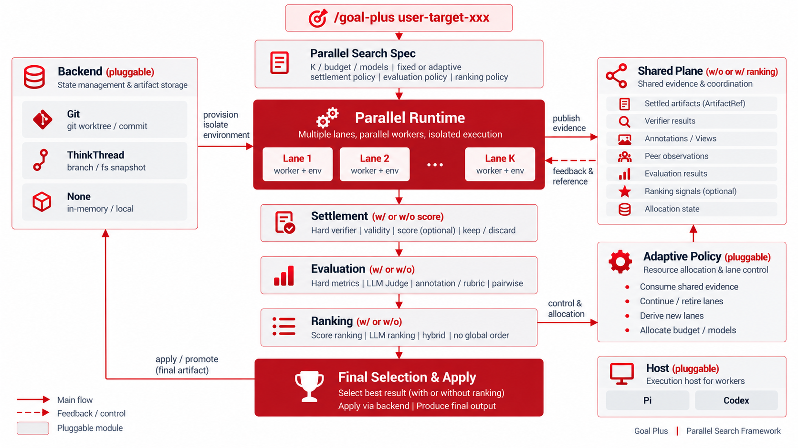

<!-- markdownlint-configure-file {"MD033":{"allowed_elements":["details","summary","div","b"]},"MD013":false,"MD041":false} -->

[English](README.md) | 简体中文

<div align="center">

# Goal Plus

**并发、共享、智能。**

</div>

Goal Plus 是 [Muyuan](../../README.md) 中面向复杂优化任务的多 Agent 协作运行时。围绕同一目标，让候选独立探索、共享验证结果与可复用工具，并根据反馈持续改进方案。


<summary><b>📋 目录</b></summary>

- [Goal Plus](#goal-plus)
  - [📘 1. 核心能力](#-1-核心能力)
  - [📅 2. 近期进展](#-2-近期进展)
  - [🔧 3. 支持与安装](#-3-支持与安装)
    - [支持范围](#支持范围)
    - [候选工作方式](#候选工作方式)
    - [安装准备](#安装准备)
    - [选择安装方式](#选择安装方式)
  - [🚀 4. 快速开始](#-4-快速开始)
  - [📖 5. 优化示例](#-5-优化示例)
  - [📐 6. 架构概览](#-6-架构概览)
  - [📂 7. 代码目录指引](#-7-代码目录指引)
  - [📚 8. 文档](#-8-文档)
  - [📄 9. 许可证与第三方来源](#-9-许可证与第三方来源)


## 📘 1. 核心能力

| 能力 | 能为你做什么 |
| --- | --- |
| **持续迭代优化** | 围绕目标反复提出方案、修改实现和验证效果，保留尝试历史并支持显式续跑。 |
| **并行探索路线** | 多个候选各自保留工作区与会话，独立尝试不同的优化方向。 |
| **共享有效发现** | 通过共享 Evidence 和工具复用实验结果与诊断方法，让候选相互借鉴，减少重复试错。 |
| **验证与择优** | 以可验证的结果比较候选方案，结合正确性检查与效果评估，提高交付可靠性。 |

## 📅 2. 近期进展

<!-- 日期对应相关开发提交，不代表正式发布或宿主验收日期。 -->

| 日期 | 主要进展 |
| --- | --- |
| 2026-09-18 | **[ThinkThread Codex 支持](docs/codex.md#支持范围与验证)**：在私有 Child 中运行 Codex 候选，验证快照并回写结果。 |
| 2026-09-14 | **[LLM Verifier](docs/llm-verifier.md)**：评价已结算结果的质量，为选择与分配提供评分。 |
| 2026-09-07 | **[统一任务管理与执行接口](docs/agent-host-adapters.md)**：任务状态按职责分层，Codex/Pi 共用执行接口。 |
| 2026-09-02 | **[自适应搜索](docs/adaptive-search.md)**：根据验证反馈调整候选探索与资源分配。 |
| 2026-09-02 | **[ThinkThread Pi 支持](docs/pi.md)**：在私有 Child 中运行 Pi 候选，验证快照并回写结果。 |
| 2026-08-29 | **[独立终审（Final Check）](docs/runtime-logic.md)**：按目标与任务 Skill 独立复核交付结果。 |
| 2026-08-20 | **[Ultra 编排](docs/ultra.md)**：支持普通任务的子 Agent 委派、返工与结果验收。 |
| 2026-08-20 | **[共享目录](docs/shared-plane.md)**：支持候选工具的受控发布与复用，保持工作区隔离。 |
| 2026-08-17 | **[初始版本](SPEC.md)**：Goal/Search 双模式、Pi/Codex 接入、冻结验证、隔离探索与回滚、共享证据与结果交付。 |

## 🔧 3. 支持与安装

当前支持 **Pi** 和 **Codex**，候选可通过原生会话直接执行，或交给 **ThinkThread** 托管。

### 支持范围

Search 支持以下宿主、执行后端、候选工作方式与工作区组合：

| Agent 宿主 | 执行后端（runtime provider） | 候选工作方式（inner agent） | 工作区（workspace provider） |
| --- | --- | --- | --- |
| Pi | `direct` | `autoresearch`（默认）、`common` | `git_worktree` / `copy` |
| Codex | `direct` | `autoresearch`（默认）、`common` | `git_worktree` / `copy` |
| Pi | `thinkthread` | `common`（默认）、`autoresearch` | `thinkthread` |
| Codex | `thinkthread` | `common` | `thinkthread` |

**工作区说明：** `git_worktree` 分离代码树；direct worker 另有默认宿主 sandbox 策略。依赖和可写范围见 [Sandbox 设计与支持](docs/sandbox.md)，产物交付见 [Workspace 架构](docs/workspace-sandbox-arch.md)。

### 候选工作方式

- **`autoresearch`（迭代探索）**：采用 AutoResearch 风格的迭代流程，维护候选本地 Git 尝试历史与 `results.tsv`。
- **`common`（单次尝试）**：每次派发完成一次尝试，后续由 Main 决定是否继续。

使用 `inner_agent=` 选择候选工作方式，详见[宿主适配](docs/agent-host-adapters.md)。

### 安装准备

- **基础工具**：Git，以及已安装并配置好模型访问的 Pi 或 Codex CLI。
- **Pi 依赖**：通过 npm 安装的 Pi CLI，以及 Node.js 和 npm。
- **Python 环境**：安装器通过 uv 准备受管 Python 3.12 和锁定依赖，首次安装需要联网下载。

获取社区仓库源码，进入插件目录：

```bash
git clone https://gitcode.com/openeuler/muyuan.git
cd muyuan/plugins/goal-plus
```

### 选择安装方式

以下安装命令均从 `muyuan/plugins/goal-plus/` 目录运行。

<details open>
<summary>使用 Pi：原生执行</summary>

```bash
./install.sh --pi
```

安装完成后，在目标项目中启动 `pi`，使用 `/goal-plus` 命令。配置说明见 [Pi 指南](docs/pi.md)。

</details>

<details>
<summary>使用 Codex：原生执行</summary>

```bash
./install.sh --codex
```

首次安装后，新建线程，在 `/hooks` 中检查并信任 Goal Plus，然后再新建一个线程。在目标项目中启动 `codex`，使用 `$goal-plus` 命令。配置说明见 [Codex 指南](docs/codex.md)。

</details>

<details>
<summary>使用 ThinkThread：托管 Pi / Codex 执行</summary>

需要独立安装 ThinkThread Linux Runtime，并配置好对应宿主。选择其中一组命令，生成 Goal Plus Profile 并启动 Root：

**Pi：**

```bash
./install.sh --pi --thinkthread
tt run --profile goal-plus-pi --fs /path/to/your-project
```

**Codex：**

```bash
./install.sh --codex --thinkthread
tt run --profile goal-plus-codex --fs /path/to/your-project
```

在 Root 中使用对应宿主的目标命令，并通过 `workspace_provider=thinkthread` 指定 Search 工作区。候选由 ThinkThread Child 执行，结果经过快照验证与发布。

Goal Plus 不安装、升级或删除 ThinkThread 本身。TT Codex 显式 worker 模型必须来自 Profile allowlist，并使用精确的 `provider/model`；其 Root 不支持 Ultra delegation、独立 final check 与 Stop-hook 续跑。完整边界见 [Codex 支持范围](docs/codex.md#支持范围与验证)。

</details>

<details>
<summary>开发环境、更新与卸载</summary>

正常安装绑定不可变代码版本，修改 checkout 不会自动更新已安装插件。重新运行对应安装命令可更新安装；已有注册会询问是否卸载重装。检查已安装版本：

```bash
./install.sh --runtime-info
```

准备 checkout 本地测试环境：

```bash
uv sync --locked
uv run --frozen python -m pytest -q
```

需要直接加载当前 Pi 源码时，使用独立开发入口：

```bash
./install.sh --pi-dev
source .goal-plus-dev/set_env.sh
```

随后在目标项目中运行 `pi-goal-plus`。`--pi` 与 `--pi-dev` 不能在同一次安装命令中使用。更新已有 ThinkThread Profile 时，仍需带 `--thinkthread` 运行对应安装命令。

卸载前先查看计划：

```bash
./uninstall.sh --dry-run
```

`./uninstall.sh --pi` 和 `./uninstall.sh --codex` 分别移除对应宿主注册；卸载不删除目标项目的 `.gp/` 记录，也不回退已经应用的修改。完整的更新、迁移与组件清理规则见[开发指南](docs/development.md)。

</details>

## 🚀 4. 快速开始

在待优化项目中启动已安装 Goal Plus 的宿主：

```bash
cd /path/to/your-project
pi  # 使用 Codex 时改为 codex
```

选择可用模型，在会话中提交优化目标；下方尖括号内容替换为你的实际要求：

```text
/goal-plus <优化目标、可修改范围与验收标准>
```

Codex 使用 `$goal-plus <优化目标、可修改范围与验收标准>`。已有基准测试时，可在目标中指定其入口。Goal Plus 使用当前 Main 会话，由 Main 准备评价合同、组织探索并审查结果。完整可运行任务见[优化示例](#-5-优化示例)。

<details>
<summary>查看状态、控制任务与获取结果</summary>

以下命令用于绑定了该 Goal 的 Pi 会话；本地 Codex 使用相同子命令，前缀改为 `$goal-plus`。

| 命令 | 作用 |
| --- | --- |
| `/goal-plus summary` | 显示当前 Goal 的状态；不带参数的 `/goal-plus` 也执行此操作。 |
| `/goal-plus pause` | 暂停后续续跑与新派发，不强杀当前轮。 |
| `/goal-plus resume` | 显式恢复可继续的 Goal，保留原有截止时间与累计用量。 |
| `/goal-plus edit <完整的新目标>` | 更新目标；已暂停的任务不会因编辑自动恢复。 |
| `/goal-plus clear` | 永久撤销该 Goal 的执行权限，保留历史。 |

恢复原生对话不等于恢复任务。ThinkThread Codex Root 不支持 Stop-hook 续跑，不能套用本地 Codex 的恢复操作；完整说明见[运行逻辑](docs/runtime-logic.md)和 [Codex 支持范围](docs/codex.md#支持范围与验证)。

Search 收尾后可查看选中产物、验证记录与终态 `report.md`、`report.html`，以完成时返回的实际路径为准。本地默认状态目录为 `.gp/`，ThinkThread 使用原生会话的私有目录。启动宿主时设置 `GOAL_PLUS_DEBUG=1`，即可自动采集诊断并刷新 `host-logs/agent-transcript/index.html`，无需额外启动脚本。会话导出与排障见[调试指南](docs/debugging-runtime.md)；公开分享前检查并脱敏日志。

</details>

## 📖 5. 优化示例

<details>
<summary>Circle Packing：并行搜索更好的圆布局</summary>

在满足边界与不重叠约束的前提下，优化 26 个圆的半径和。从 `plugins/goal-plus/` 进入示例目录，启动 Pi 后完整粘贴 [pi-goal-prompt.md](examples/circle-packing/pi-goal-prompt.md)：

```bash
cd examples/circle-packing
pi
```

任务代码和 verifier 只依赖 Python 标准库，宿主仍需模型访问。运行前保持外层 Git 仓库干净；不要进入 `workspace-template/` 启动或修改只读模板。候选结果与报告保存到 `.gp/`，不向原模板回写。详见 [Circle Packing](examples/circle-packing/README.md)。

需要将结果应用回源码时，使用相应的 [Git Apply](examples/circle-packing-git-apply/README.md) 或 [ThinkThread Apply](examples/circle-packing-thinkthread-apply/README.md) 示例。

</details>

<details>
<summary>PyPTO：优化已有算子的 NPU 执行性能</summary>

在已有 PyPTO 实现上探索优化方案，保持输入、功能和精度标准不变，并在真实设备上测量性能。当前提供 CSA、MoE 两个任务入口与 Codex、Pi、ThinkThread + Pi 的运行说明。

需要匹配的 PyPTO、simpler、PTOAS、CANN 工具链与两张可用卡；源码和运行环境在仓库外准备。性能须在目标设备上测量，不能用 CPU 正确性检查替代。按 [PyPTO Optimize](examples/pypto/optimize/README.md) 准备环境并使用对应完整 prompt。

</details>

<details>
<summary>VLIW：优化程序调度，减少模拟执行周期</summary>

在保持输出正确的前提下，优化生成程序的 VLIW/SIMD 调度，降低本地模拟器统计的执行周期。任务代码与模拟器只依赖 Python 标准库，不需要加速器硬件。运行方式与完整 Pi prompt 见 [VLIW Kernel Optimization](examples/vliw-kernel-optimization/README.md)。

</details>

更多任务见[示例索引](examples/README.md)。示例中的公开反馈用于比较本任务的优化结果，不等同于隐藏评测成绩。

## 📐 6. 架构概览



**Main Agent** 理解目标、设计验收条件并决定直接执行、委派或 Search； **Goal / Search Runtime** 保存任务状态、冻结合同、候选 Evidence 与发布记录； **执行适配层** 对接 Pi/Codex 原生会话，以及 ThinkThread 的 Child 执行与控制。

候选通过共享平面读取被允许的证据与产物，不共享私有推理或任意访问其他候选工作区。 LLM Verifier 的可选质量评价不改写硬 verifier 分数，Selection 与 Allocation 使用确定性策略。详细说明见[架构图集](docs/architecture.md)、[共享平面](docs/shared-plane.md)和 [系统规格](SPEC.md)。

## 📂 7. 代码目录指引

以下路径相对于 `plugins/goal-plus/`：

| 目录 / 文件 | 用途 |
| --- | --- |
| [src/goal_plus/](src/goal_plus/) | 领域模型、应用用例、宿主执行与基础设施适配。 |
| [assets/](assets/) | Codex / Pi 配置、角色资产与公共 instructions。 |
| [examples/](examples/) | 用户示例、任务输入及其来源说明。 |
| [docs/](docs/) | 架构、接口、安装、恢复与排障专题。 |
| [tests/](tests/) | 默认回归、集成测试及显式启用的真实宿主测试。 |
| [scripts/](scripts/) | 安装、监控、诊断与文档生成工具。 |


## 📚 8. 文档

| 我想…… | 从这里开始 |
| --- | --- |
| 安装、更新或开发插件 | [开发指南](docs/development.md)、[Codex](docs/codex.md)、[Pi](docs/pi.md) |
| 了解命令、参数及状态控制 | [API](docs/api.md)、[运行逻辑](docs/runtime-logic.md) |
| 理解候选之间如何协作 | [共享平面](docs/shared-plane.md)、[Evidence Annotator](docs/evidence-annotator.md) |
| 配置评价与自适应策略 | [LLM Verifier](docs/llm-verifier.md)、[Adaptive Search](docs/adaptive-search.md) |
| 排查执行、恢复或报告问题 | [调试指南](docs/debugging-runtime.md)、[Search 恢复](docs/search-recovery.md) |
| 找到全部专题与代码入口 | [文档地图](docs/README.md)、[系统规格](SPEC.md) |

## 📄 9. 许可证与第三方来源

第三方示例的来源与许可说明随各自目录维护，入口见[示例索引](examples/README.md)。

技术细节：[Sandbox 设计与支持](docs/sandbox.md)。
