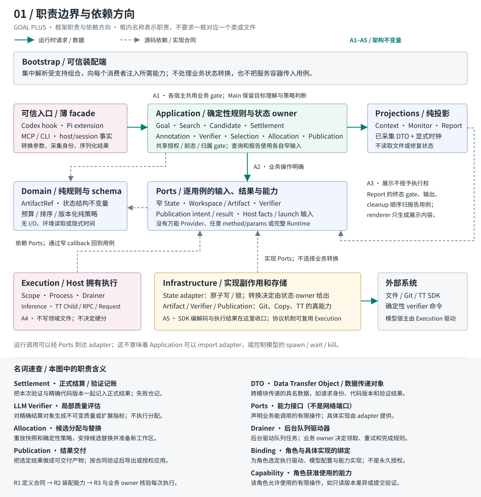
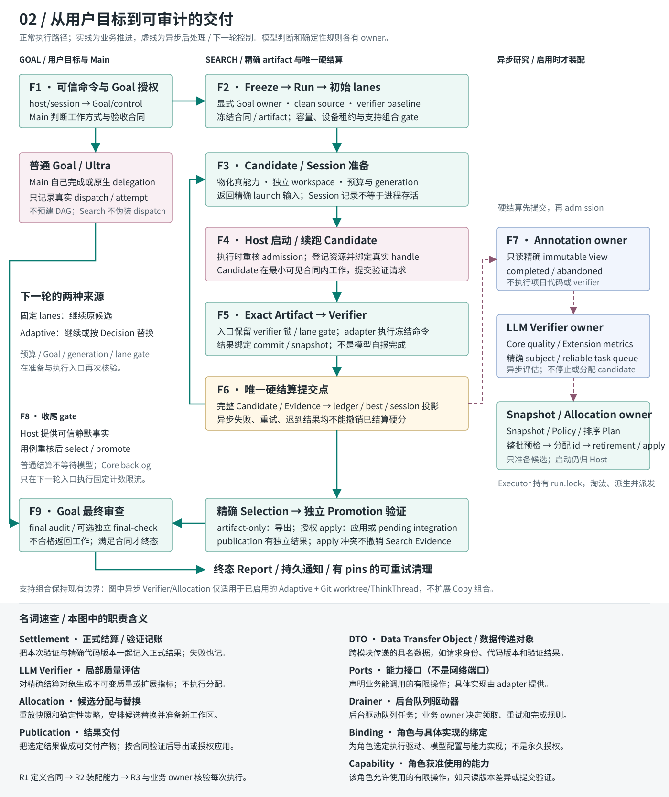
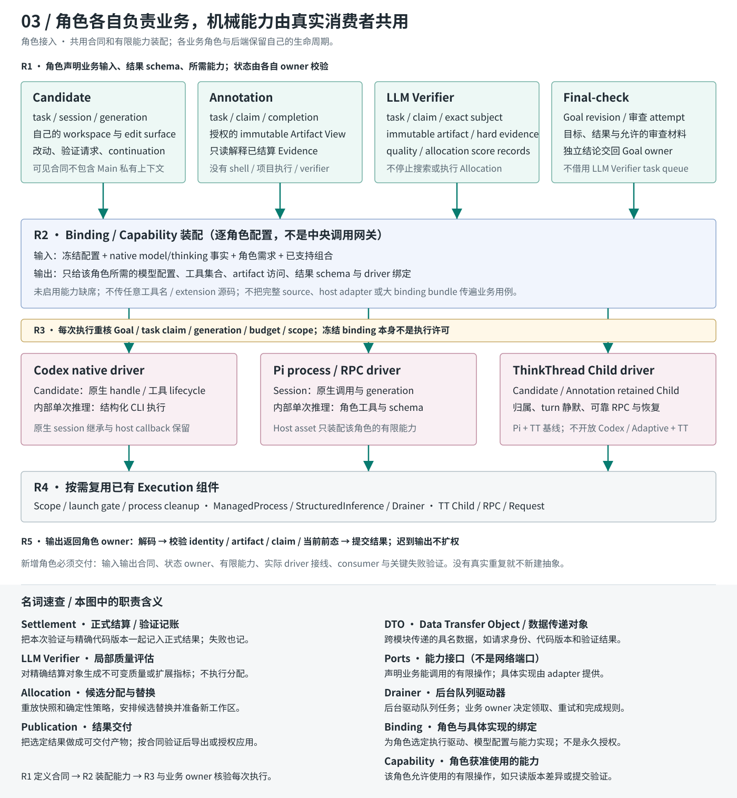
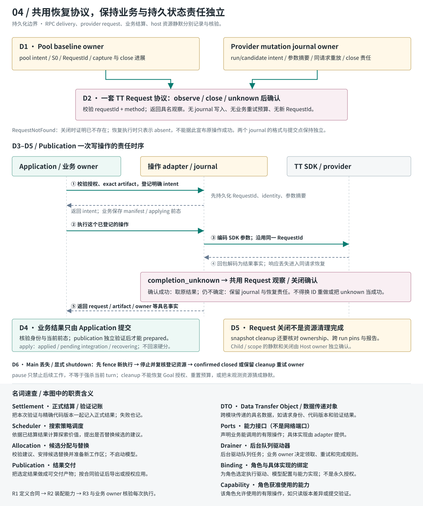

# Goal Plus 架构图集

本文说明当前框架的职责、依赖方向、角色能力和持久化边界，配合
[系统规格](../SPEC.md)及[开发约定](../AGENTS.md)阅读。
支持的宿主与后端组合见 [Host Adapters](agent-host-adapters.md)。
图中的框表示职责边界，不规定必须创建同名类、文件或新的持久模型。

浏览入口：[连续看图页面](architecture.html)。SVG 可单独打开、放大或下载：

| 图 | 要回答的问题 |
| --- | --- |
| [01 职责边界与依赖](diagrams/01-boundaries.svg) | 业务规则放哪里，副作用谁执行，接口如何限定能力？ |
| [02 完整业务流程](diagrams/02-flow.svg) | 从 Goal 到 Search、异步研究、最终审查和交付，谁推动下一步？ |
| [03 角色接入与装配](diagrams/03-roles.svg) | 新 agent 如何接入，哪些机械能力复用，哪些生命周期必须独立？ |
| [04 持久责任与恢复](diagrams/04-durability.svg) | TT request 恢复由谁处理，哪些 journal、提交点和 cleanup 责任独立？ |

## 先认识这些名词

Agent 身份、执行托管和工作区是三个独立维度：`agent_harness=codex|pi`、
`runtime_provider=direct|thinkthread`、`workspace.provider=copy|git_worktree|thinkthread`。
Domain 校验支持组合；Infrastructure 从可信 Main 身份和工作区要求装配冻结执行绑定；
Application 保留授权和状态转换；Execution 保留 native/Child 生命周期。
ThinkThread 不是 agent 身份，也不决定搜索方向、评分或 publication。
进程生命周期交给 agent/宿主。GP 不维护平台进程身份、进程组观测或 guardian；
Execution 只操作当前持有的直接句柄，Scope 负责 session/activation admission 和登记释放。
当前只支持 Codex/Pi direct Copy/Git 和 Pi ThinkThread TT workspace；不扩展第三种 harness。

这些词分为几组：前四个描述业务流程，DTO/Ports 描述模块之间的合同，Drainer 描述后台
执行机制，Binding/Capability 描述角色如何接入与获得能力。每张 SVG 底部都有简短词表。

| 名词 | 通俗含义 | 在 Goal Plus 中的具体职责 |
| --- | --- | --- |
| Settlement | 正式结算，也就是一次验证的正式记账 | 把精确代码版本、verifier 结果、分数与本轮处理结论记录下来，提交候选状态，并更新 ledger/best 等投影。通过和失败都需要结算；不是“宣告整个目标完成”，后续异步任务失败也不能撤销已经记下的硬分。 |
| LLM Verifier | 对一个已结算 artifact 做局部质量评估 | 通过一个可靠 task 和一次结构化调用生成包含质量与可选 allocation scores 的不可变 record。它不比较最终候选、不停止搜索、不退休 lane，也不创建 Decision。 |
| Allocation | 通过确定性策略安排候选分配与替换 | 从不可变 Snapshot 计算并校验 Decision，预检容量、来源和归属，安排旧候选退出与派生候选准备，记录应用进度以支持幂等恢复。模型进程仍由 Host 启动。 |
| Publication | 把选中的搜索结果变成可交付产物 | 准备 patch、commit 或 TT publication snapshot，按合同完成独立验证，导出供 Main 使用或在授权后应用到源工作区。它不是“发布到公网”；应用冲突可以保留交付物并等待 Main 集成。 |
| DTO | Data Transfer Object，数据传递对象 | 跨模块传递的一份有明确字段的数据。例如“请求 ID、目标代码版本、执行结果”。它装数据，不负责启动进程或选择业务状态转换；可以用 dataclass/Pydantic 等表达，不要求新增 DTO 基类。 |
| Ports | 模块对外声明的能力接口 | 例如“读取这两个版本的差异”或“应用这个已登记的 publication intent”。接口说明允许什么输入、返回什么结果；Git/TT 等 adapter 负责真正实现。这里的 port 不是 TCP/HTTP 的网络端口。 |
| Drainer | 后台队列驱动器 | 有 Annotation/LLM Verifier 待办时，启动或唤醒受管的后台处理，驱动队列消费，并处理重复唤醒、执行归属和退出重扫等机械工作。具体任务能否领取、如何重试、何时完成仍由各业务 owner 决定；它不选择 winner，也不监督全部 candidate。 |
| Binding | 把角色接到具体配置和实现上 | R2 中指为一个角色选定执行驱动、模型配置、能力实现并完成接线，例如 Annotation 使用 Pi 单次推理并接入只读 Artifact View。它不是基类，也不是永久执行许可；实际 native handle/session 的归属绑定在后续执行阶段完成。 |
| Capability | 角色被授予的有限能力 | 说明允许哪些操作，例如读取授权版本的差异、修改自己的 allowed files 或提交验证请求。它不等于底层 SDK 的全部方法。只读角色不能因为底层实现会执行 shell，就自动获得 shell 工具。 |

举例：某候选改了一版代码，verifier 测出分数 0.82。**Settlement** 把该版本和 0.82 正式
记下来；**LLM Verifier** 对该精确版本生成完整局部评估记录；启用 Adaptive 时，确定性
**Allocation** 从全局 Snapshot 判断是否替换 lane 并准备新候选，Host 再启动它。Search 收尾选中结果后，
**Publication** 将它整理成可交付产物，并按授权导出或应用。

这些步骤之间，**DTO 是传递的数据，Ports 是允许调用的能力，adapter 是能力的具体实现**。
Annotation/LLM Verifier 的后台待办由 **Drainer** 驱动，但选择、结算和替换规则不归 Drainer。
这段例子描述各职责的衔接，不表示每次结算都必须触发候选替换。

## 01 职责边界

绿色实线表示运行时请求或数据流，灰色虚线表示源码依赖或实现合同。
例如 Application 通过 Artifact port 执行 I/O，但源码不能依赖具体 Git/TT adapter。
图仅画主要关系，完整允许依赖仍以 AGENTS 的分层约束为准。

Main 负责理解目标、选择方向和审查价值；Application 根据可信输入和持久状态执行可确定的
授权、归属、预算和前态规则。Domain 提供严格 schema 与纯策略。二者都不监督模型进程。
Verifier 是确定性副作用，用例可以通过窄 port 调用冻结命令；这不授予模型生命周期控制权。

Host 驱动 Execution，负责真实 native handle、进程、Child、RPC 和 scope。
Execution 通过注入的窄 callback 取得 admission 或回报事实，不自行构造 Runtime/业务 store。
Bootstrap 负责把这些真实实现接起来，不让消费者拿到一个能够随意找 service 的容器。

“窄接口”必须同时体现在签名和底层实现：调用方只有所需操作，操作接受明确输入，返回
已解码的事实；对应旧入口退出。只换 import、把 method 改成枚举、或再包一个转发对象，
都不足以证明收敛。允许真实 Git/Copy/TT 差异，不要求不支持的能力实现一个永远抛错的方法。

## 02 完整流程

Goal 是用户目标的授权与收尾边界。普通工作由 Main 自己完成或进行原生 delegation；Ultra
记录真实 dispatch，不要求预建 DAG。Search 有自己的 FrozenSpec、candidate、Evidence 和
promotion，不能塞进普通 subagent dispatch 状态模型。

Search 主线是冻结合同、创建候选、准备 session、Host 执行、精确 artifact 验证和硬结算。
Candidate/Session 用例返回 launch 输入，Host 启动实际 worker。每轮的 ArtifactRef、verifier
结果和硬分绑定；先完整提交 authoritative Candidate/Evidence，再更新相关派生投影。

Annotation 与 LLM Verifier 属于结算后的工作。单一 Verifier task 与 Annotation 各自可靠执行；
Verifier 的一次结构化调用同时生成 `quality_score` 和可选 `allocation_scores`。普通 iteration 不同步
等待模型任务，Verifier backlog 也不参与 candidate admission。只有 AllocationPolicy 生成的 pending
retirement Decision 才 fence 对应 lane；Search runtime 不加入模型等待循环。

Adaptive reconciliation 从不可变 records 构建 Snapshot，纯 FeaturePipeline/AllocationPolicy 产生
逻辑 plan，Allocation owner 重算后持久化唯一 Decision、预检并应用替换。LLM Verifier 的任务、
记录和 drainer 独立于 AdaptiveSearch；AdaptiveSearch 只暴露 Decision 查询与 apply，不是另一个
supervisor。固定 lanes 继续原候选；Adaptive 可能准备派生候选，实际启动仍归 Host。

收尾要求可信静默事实与 exact selected artifact。Promotion 有独立 Evidence；TT 验证的是从
基线加授权产品改动形成的 publication snapshot，不能直接把 candidate snapshot 当作待应用
产物。artifact-only 导出；授权 apply 遇到冲突可以进入 pending integration，不能撤销 Search
已经成立的 Evidence。Goal 再按其合同审查结果，必要时进行独立 final-check。

图底部合并了报告、通知与资源清理的展示，**不代表三者必须同时或一律依次触发**：publication
终态可先产生持久通知，Goal/Search 终态后报告用例按现有 output/cleanup/refresh 顺序生成
报告；snapshot 清理还受 ownership、引用 pins 和报告持久性约束。Report renderer 只做纯投影。

## 03 角色接入

可以理解为各角色通过 R2 获得一致、受限的能力装配，但**不是 R2 单独定义全部接口、也不是
所有运行时调用都必须经过一个中央 R2 服务**。图中的 R1/R2/R3 是职责分段，不是要求新增
三个统一网关。

| 环节 | 限定什么 | Annotation 的例子 |
| --- | --- | --- |
| R1：业务合同 | 输入输出 schema、可调用的窄 Ports，以及由哪个 owner 接受结果 | 声明任务、claim、结果格式与精确 Artifact View 读取接口 |
| R2：可信装配 | 从已支持组合中选择 binding，投影该角色的 capability，并接入具体实现 | 绑定 Pi 单次推理或受支持的 TT Child 路径；只装配授权 View 的读取工具 |
| R3 与业务 owner：执行时核验 | 当前身份、claim/generation、预算、scope、artifact 和状态前态 | 即使配了读取能力，也必须拒绝读取未授权版本；旧 claim 不能提交新结果 |

因此 capability 回答“允许做什么”，binding 回答“由哪种具体实现和配置提供”。
接口设计、能力装配、工具权限和业务前态校验共同约束流程。R2 不能替代执行时授权；
也不能为了统一装配，再把完整 Runtime/provider/host 服务包交给每个 agent。

统一接入的单位是角色的合同和所需能力，而不是一套统一任务状态机。Candidate、Annotation、
LLM Verifier 和 Final-check 分别保留自己的授权、任务领取、结果验收与恢复责任。
Final-check 属于 Goal；LLM Verifier 属于 Search 的异步局部评估，二者不能共用一个业务队列 owner。

装配端解析冻结配置、可信 native model/thinking 事实和已支持组合，再投影角色所需能力。
未启用的工具不出现在模型合同中；执行工具白名单必须来自同一能力依据。只读消费者不应拿到
launch/apply/write_best 等多余接口。角色不能提交任意工具名或 extension 源码来自行扩权。

图中执行驱动是可选绑定，不表示任意角色与后端都能组合。Codex native candidate、Pi RPC
worker、TT retained Child 的身份和生命周期不同，保留各自 driver；内部单次结构化推理、
受管进程、drainer、scope、TT Child/RPC/Request 等机械机制按真实使用复用。

新增角色的最小交付是输入输出 schema、确定性状态 owner、有限能力需求、真实 driver 接线、
结果 consumer 和少量关键失败验证。不是每个角色都新建一套 process、monitor、retry 或
RPC 实现；也不因增加一个角色预建通用 Agent 基类、注册器、事件总线或新的持久 binding。

## 04 恢复与提交

图上半部分说明 baseline 准备如何使用 provider mutation journal，下半部分用一次 publication 写操作说明提交时序。快照物化
与 source apply 是两次独立操作、两个 intent；不能把图理解成单个 request 横跨整条发布链。

Search baseline 通过 provider mutation journal 保存 S0 捕获的 intent、参数摘要、结果和
关闭责任；candidate 使用 run 已冻结的准确 baseline，不再由 pool 重复捕获。
同一 journal 也记录 run/candidate 的其他 provider mutation。共同 Request 组件只观察、
确认关闭并核验 exact requestId/method，不合并 journal、不换 RequestId，也不决定业务重试。
RPC 消息的 hash/chunk/ack/cursor 是另一层协议，其成功不能证明文件系统操作成功。

每次副作用先登记 durable intent，再由业务 owner 保存对应 manifest/applying 前态，然后
adapter 编码和执行。响应丢失时恢复原请求；adapter 返回具名事实，Application 继续复核它
是否属于当前 intent、owner 与 artifact。独立 verifier 和最终 Promotion 提交仍归原业务路径。
run 锁和单文件原子写不是跨文件事务，崩溃后的投影修复必须沿 authoritative commit 幂等重放。

Request 已关闭、snapshot 可以删除、Child 已静默、scope 可完成、Goal 可恢复，是不同结论。
Snapshot cleanup 根据持久 ownership 和 pins 决定；Host cleanup 根据登记资源与可信观测决定。
未知结果保留准确身份和后续重试 owner，不以“任务已终态”代替“进程已退出”。

普通 pause 不强杀当前 turn。Main 丢失或需要关闭 scope 时，先 fence 新执行，再停止并复核
资源；cleanup 不重新激活 Goal，不重置预算。恢复工作需要显式恢复授权和当前代际 gate。
未观测逃逸后代的内核级追踪不属于当前资源清理保证。

## 状态责任表

“状态 owner”决定合法转换；“文件 adapter”执行锁与写入。具体存储可以保留原复合记录，
消费者通过裁剪后的接口使用它，不要求为每个 port 复制一套文件或数据库。

| 状态 / 事实 | 唯一转换或采集责任 | 其他模块可以做什么 |
| --- | --- | --- |
| Goal revision/control、dispatch、final-check | 对应 Goal 用例；host 提供可信 session/command | Main 提判断；Search 通过授权后的 Goal link 协作 |
| FrozenSpec/run/candidate/session | 各 Search 用例与 candidate/session owner | Host 消费 launch 输入、绑定真实 handle，不用 session 记录猜 liveness |
| Verifier Evidence / hard score | 唯一硬结算 owner；hard verifier adapter 只执行冻结验证 | Annotation/LLM Verifier/查询只读已结算事实，不回写硬分 |
| AnnotationTask / VerifierTask / VerifierRecord | 各自 admission/claim/completion/retry 或不可变 record owner | Host 执行一次任务并交回结果；失败不撤销硬结算 |
| SearchSnapshot / FeatureView | Adaptive 纯计算与只读装配 | 可删除并从权威记录重建，不修改 candidate 或 verifier record |
| AllocationDecision / applied 投影 | Allocation owner | 确定性 policy 产生逻辑 plan；candidate creation 负责被授权的物化与 session 准备 |
| Selection / Promotion / apply outcome | 各 publication 用例 | Adapter 返回协议事实；Host 提静默事实；都不能自行宣布业务通过 |
| Baseline snapshot / source handle | Search bootstrap 与 provider mutation journal | Candidate 消费冻结的准确 baseline，不重新捕获 |
| Provider mutation journal | Mutation journal owner | 具体操作 adapter 使用原 intent；Request 组件不决定重新执行 |
| Scope / handle / process / drainer / RPC | 对应 Host / Execution owner | 用例核验窄 host facts；不读取 PID 猜业务授权 |
| Reference / snapshot cleanup | Reference / ArtifactLifecycle owner | Provider adapter 执行已授权 I/O；报告与跨 run pins 约束清理 |
| Monitor / Report 展示 | 纯 Projections；取数和输出各有 adapter/用例 | 不由显示路径恢复领域状态，缺失观测保持 unavailable |

## 关键不变量

以下编号与图中一致，可用于定位实现的 owner 和维护时需要保护的行为。

| 编号 | 要求 | 实现审核时必须查看的证据 |
| --- | --- | --- |
| A1 | 宿主共用确定性业务 gate | Codex/Pi/TT 真实入口到同一用例的调用链及非法调用不改领域状态 |
| A2 / A5 | Ports 按操作封闭协议 | 最窄消费者签名、adapter 编解码、旧 factory/万能方法/假实现的删除记录 |
| A3 | 展示不修复状态、不授予执行权 | 查询与 context 初始化区分；renderer 输入和纯计算；report 用例的实际顺序 |
| A4 | Search 不监督模型生命周期 | Host driver 到 Execution 的真实接线；用例无 wait loop/具体 store 逃生口 |
| F1–F5 | 授权、冻结、启动、验证连续绑定 | Goal owner、FrozenSpec、candidate/session/generation、launch 和 exact artifact 的关联 |
| F6 | 硬结算有唯一提交锚点 | Candidate/Evidence 提交及投影恢复；异步失败/迟到输出不能回写硬分 |
| F7 | 异步职责和确定性 allocation 语义准确 | 单一 Verifier FIFO、Snapshot/Policy、Decision owner 与唯一 lane gate 的实际路径 |
| F8–F9 | Search 发布和 Goal 终态分别验收 | 静默事实、selected/publication Evidence、apply/pending、独立审查、报告与通知 |
| R1–R3 | 角色只能获得被授予的能力 | 确定性配置解析、模型可见工具与执行白名单、执行前身份和预算复核 |
| R4–R5 | 共用机制且结果仍归角色 owner | 至少两个真实消费者、旧机械副本退出、精确 claim/generation 校验 |
| D1–D2 | Journal 独立，Request 协议共用 | 两个持久 owner 的实际 observe/close 调用，原 RequestId 与 closing 提交点 |
| D3–D4 | Durable intent 先于副作用 | 丢响应恢复、无重复写入、错误 request/artifact 回包被拒绝、独立验证 |
| D5–D6 | 清理与恢复责任不丢失 | ownership/pins、资源登记、静默确认、unknown 的重试者和显式恢复 gate |

测试优先在对应 owner 验证确定性规则。真实 host ST 仅在开发者明确要求时运行，
使用最小角色任务并复用已有证据；参见[测试指南](../tests/README.md#module-boundaries)。
