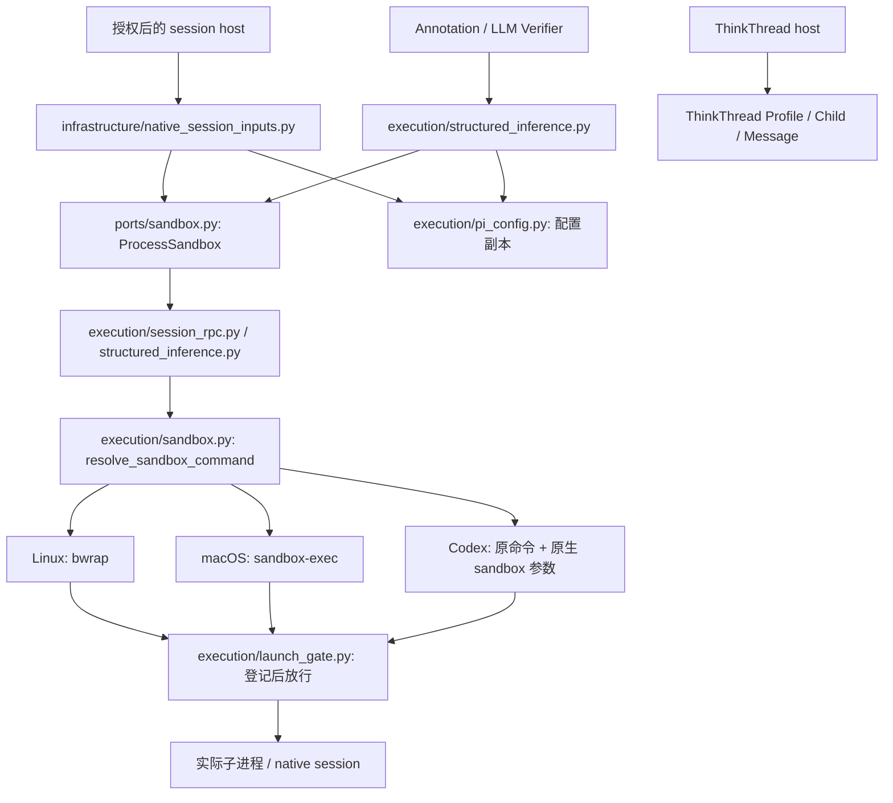

# Agent sandbox

本页统一维护 Goal Plus sandbox 的当前设计、默认安装行为、支持范围、代码职责和验证入口。
Workspace/artifact/publication 的设计另见 [Workspace 架构](workspace-sandbox-arch.md)。

## 目标与默认行为

目标是限制 Goal Plus 启动的 agent 对原始源码和其他未授权本地目录的写入，同时保留
candidate workspace 内的开发、验证和同 session 续跑。它不是完整的读隔离、凭据隔离、
网络隔离或多租户安全边界。

Direct Git/Copy worker 默认使用 sandbox，不需要安装参数或 SearchSpec 开关：

- Codex 使用原生 `workspace-write` / `read-only` 策略，不再套一层 Bubblewrap。
- Pi 使用共同 `ProcessSandbox` 声明，由 Linux Bubblewrap 或 macOS Seatbelt 包裹实际子进程。
- ThinkThread 使用自己的 Profile、Child 和 provider 文件系统边界，不经过 direct wrapper。

Git worktree 只分离代码树和 branch，`allowed_files` 只控制交付修改；二者都不能单独拦截
shell 的绝对路径写入。OS sandbox 是独立的进程启动边界。

## 写入合同与限制

`ProcessSandbox` 包含 `mode`、`backend`、`workspace`、`writable_roots` 和 `network`。
可信 host 构造声明，模型不能通过工具参数选择后端或增加写根。

Linux outer backend 将宿主 `/` 只读绑定，再开放显式 writable roots；`workspace-write`
额外开放 workspace，`read-only` 保持 workspace 只读。子进程继承同一 mount namespace。
`/tmp` 使用 namespace 内的 private tmpfs，不重新绑定宿主的全局 `/tmp`。
macOS 使用系统 `/usr/bin/sandbox-exec` 执行 Seatbelt 文件写入限制，保留必要字符设备写入，
不通过 `PATH` 选择同名程序，也不开放整个宿主 `/private/tmp`。
默认保留模型访问所需网络，`network=deny` 才额外禁网。

两端 outer launch 共用临时目录准备：默认在当前工作目录的 `.tmp/` 下创建本次进程专属
目录。可通过 `GOAL_PLUS_TMPDIR` 显式选择另一处已授权的数据盘目录。其他 I/O 错误保持
失败。仅该目录加入显式写根，并统一设置子进程的 `TMPDIR`、`TMP`、`TEMP`，不继承可能
不可写的宿主临时目录。Linux 仍在 namespace 内提供私有 `/tmp`，但 Goal Plus 分配的
scratch 目录会显式绑定进 namespace。Native session 关闭和 structured inference 完成后
清理；启动失败同样清理，强制杀死宿主可能留下临时目录。

声明路径的规范化、拒绝 filesystem root 写权限和 cwd 归属检查由共同 resolver 执行，
Linux/macOS 不各自维护一套校验。

Pi native session 显式开放 `.gp` runtime 和 session directory，供其 MCP bridge 保存状态。
Candidate 的 verifier 共享资源锁目录由 host 在替换 `TMPDIR` 前确定、创建并传入；
sandbox 仅额外开放该精确目录，不开放其父目录，也不让锁跟随 worker 的私有临时目录。
这些目录可能包含其他 candidate 的 workspace 和共享状态，因此不能声称 workspace 外
所有文件都只读，也不能把本实现当成 peer 或 runtime-private 数据隔离。
`read-only` 描述角色工作区，显式 runtime 写根仍可写。需要更强隔离时使用宿主原生能力或
ThinkThread 的受保护执行边界。

Pi Main 沿用宿主权限；只有 Goal Plus 启动的 child 经过该 wrapper。普通 native subagent
也不能作为 Goal Plus Search candidate 的 sandbox 证据。Codex 的临时目录例外和具体
工具限制由 Codex 原生策略控制，不由本 wrapper 改写。

Pi child 和 sandboxed structured inference 使用运行时目录中的配置副本。配置来源是
`PI_CODING_AGENT_DIR`，未设置时使用 `~/.pi/agent`；仅复制模型、认证和 settings 文件，
不开放原始配置目录的写权限，不覆盖已存在的 session 配置。复制文件权限为 `0600`。
该副本仍含模型访问所需认证，不能据此承诺 credential 读隔离。

缺少 outer backend、平台不支持或 namespace 权限不足时拒绝执行，不退回裸命令。
声明为 `native` 的进程由 Codex 执行原生策略；两端使用同一声明接口，不要求底层 sandbox
实现或 writable roots 完全相同。

## 支持范围

| 场景 | 默认策略 | 写入范围 | 验证范围与限制 |
| --- | --- | --- | --- |
| Linux Pi direct Git/Copy candidate | Bubblewrap，workspace-write | candidate workspace、显式 runtime/session roots、private `/tmp` | Circle Git E2E 覆盖源码/外部文件拒写、symlink、子进程和同 session 续跑；Copy 未在该 E2E 验收 |
| Codex direct Git/Copy candidate | Codex native workspace-write | 由 Codex 原生策略执行 | Circle Git E2E 覆盖相同写入 probe 和续跑；Copy 未在该 E2E 验收 |
| macOS Pi direct Git/Copy candidate | Seatbelt，workspace-write | workspace、显式 runtime/session roots、专属临时目录 | 共用 Circle Git E2E 覆盖源码/外部文件拒写、symlink、子进程和同 session 续跑；Copy 未在该 E2E 验收 |
| Direct ordinary delegation | Codex native / Pi outer，workspace-write | 被授权 workspace 和对应运行时写根 | 已有接线测试，未作为 Circle sandbox E2E 的独立角色验收 |
| Direct final checker | Codex native / Pi outer，read-only | 工作区只读；Pi runtime/session roots 仍可写 | 共同 outer backend 已有真实 read-only 写入测试；checker 角色端到端负向 probe 未覆盖 |
| Direct Annotation / LLM Verifier structured inference | Codex native read-only / Pi outer scratch workspace-write | Codex 原生限制；Pi invocation 临时目录 | 已统一启动声明与 Pi 配置复制；独立角色的真实负向 probe 未覆盖 |
| ThinkThread LLM Verifier | self Profile / fresh Message-only Child | 不开放文件或命令工具，仅本次输入和评分提交 | 不调用本地 bwrap；受控 transport 测试覆盖分流与清理，真实宿主尚未验收 |
| Pi Main / GP 外的 native subagent | 宿主自身权限 | 取决于宿主 | 不在 GP direct sandbox 承诺内 |
| ThinkThread candidate | ThinkThread Profile/Child | provider 授权文件系统 | 使用独立 provider 接线，支持边界见 [Codex](codex.md)、[Pi](pi.md) |

Linux 不依赖 Landlock。Bubblewrap 使用 user/mount/PID namespace 和 bind mount；是否能运行
取决于内核功能、发行版策略与容器权限，而不只是内核版本号。Linux 5.10 已完成 Circle
验收，但不声明一个未经验证的最低内核版本。更旧或更受限的环境应运行实际 preflight。

macOS direct Pi 采用 Seatbelt，适用于本页的文件写入限制目标。`sandbox-exec` 已被 Apple
弃用，自定义 SBPL 不属于官方支持的第三方接口，不能承诺未来系统版本兼容；见
[Apple DTS 说明](https://developer.apple.com/forums/thread/661939)。后端缺失或执行失败时拒绝启动。

## 当前代码架构



| Owner | 当前代码 | 职责 |
| --- | --- | --- |
| Ports | [sandbox.py](../src/goal_plus/ports/sandbox.py)、[session.py](../src/goal_plus/ports/session.py)、[inference.py](../src/goal_plus/ports/inference.py) | 纯执行声明，不启动进程或授予业务权限 |
| Infrastructure | [native_session_inputs.py](../src/goal_plus/infrastructure/native_session_inputs.py) | 从已授权角色、workspace 和 runtime 输入装配两端 launch 声明 |
| 角色 host | [evidence_annotator.py](../src/goal_plus/evidence_annotator.py)、[llm_verifier.py](../src/goal_plus/llm_verifier.py) | 为内部推理传入 runtime-scoped sandbox；保留角色 admission/结果验收 |
| Execution 配置 | [pi_config.py](../src/goal_plus/execution/pi_config.py) | 两处真实启动路径共用的 Pi 配置副本；不读写领域状态 |
| Execution sandbox | [sandbox.py](../src/goal_plus/execution/sandbox.py) | 共同路径/root/cwd 校验、专属临时目录与环境、OS wrapper argv；不构造 Runtime |
| Execution 启动 | [session_rpc.py](../src/goal_plus/execution/session_rpc.py)、[structured_inference.py](../src/goal_plus/execution/structured_inference.py) | 实际 launch 前解析 wrapper，沿现有 registration/gate 启动、等待和清理 |
| Native session | [native_session.py](../src/goal_plus/execution/native_session.py) | Codex thread 配置、Pi RPC、准确 handle 与原生续跑 |
| 安装 | [install.sh](../install.sh)、[scripts/install.py](../scripts/install.py) | 准备 runtime/assets，报告本机依赖；不选择弱化的执行策略 |

Application/Runtime 继续负责归属、代际、artifact、Evidence、selection 和 publication，
不负责探测平台进程或监督 worker。Host callback 的领域权限仍由原 owner 核验；文件写入
wrapper 不能替代这些 gate。整体分层见 [架构图集](architecture.md)。

## 安装与系统依赖

```bash
./install.sh --codex
./install.sh --pi
# 或开发态
./install.sh --pi-dev
```

三种安装模式默认包含对应 sandbox 接线，没有 `--sandbox` 参数，也不修改 Main 的全局
sandbox 设置。安装器报告 Codex 原生策略，或检测 Pi 的 `bwrap` 是否在 `PATH`、macOS 的
`/usr/bin/sandbox-exec` 是否可执行。检测到可执行文件不等于 OS 权限已验证，最终以 worker 启动结果为准。
缺失时保留缺失状态并发出 warning，安装仍可完成；受保护 direct Pi worker 随后拒绝启动。
安装器不会调用 sudo、修改 sysctl、自动下载系统包或保存永久的可用性开关。
后端补齐后无需重装 GP；Linux 运行宿主的 `PATH` 必须能找到 `bwrap`。

Bubblewrap 是通用 Linux 系统包，通常由管理员安装：

```bash
# Debian / Ubuntu
sudo apt install bubblewrap
# Fedora / 支持该包的 RPM 发行版
sudo dnf install bubblewrap
```

先确认发行版仓库提供该包和主机允许 namespaces；macOS 使用系统 `sandbox-exec`。
不会因 Linux 缺少 Bubblewrap 而改用 Codex、ThinkThread 或不受保护的 Pi 进程。
Pi dev venv 和 bootstrap Python 应位于 `/tmp` 外，否则 private tmpfs 会隐藏解释器依赖。
安装身份、临时环境参数和刷新流程见 [开发指南](development.md)。

## 验证与诊断

[sandbox resolver 测试](../tests/test_sandbox_launch.py)覆盖两端命令策略、缺失后端拒绝、共同 cwd
边界，以及本机 Linux/macOS 实际写入限制、只读模式、checkout-local scratch 和启动失败清理；
[Pi 配置测试](../tests/test_pi_sandbox_config.py)覆盖默认及
显式配置来源、session 配置保留和宿主配置不变。

真实验收使用 [Circle Packing Git 示例](../examples/circle-packing-git-apply/README.md)。
两位 Search candidate 从 native shell 执行 [probe](../tests/st/fixtures/sandbox_probe.py)：
workspace 写入必须成功，专用外部文件、原始源码、symlink 和子进程写入必须返回 OS 权限
错误。随后进行三次有效评分、同 session 续跑、selection、独立 promotion 验证、
artifact-only 输出、源代码不变、报告和 scope cleanup。运行命令见
[测试说明](../tests/README.md#circle-role-checks)。

Linux 先用 `bwrap --version` 检查依赖；macOS 检查 `/usr/bin/sandbox-exec`。再运行共同测试：

```bash
uv run --frozen pytest -n 2 tests/test_sandbox_launch.py tests/test_structured_inference.py -q
```

namespace 或 Seatbelt 被禁止时保留错误，
不要通过修改生产主机策略或绕过 wrapper 来报告通过。长任务复用
[monitor 与 session audit](debugging-runtime.md#长时间观察)。

真实证据必须包含实际 write syscall 的拒绝和正常功能交付，不能只依赖 argv、模型自述或
文件恰好未变化。角色端到端 read-only、rename/hardlink、peer/runtime 和 interrupt/timeout
没有被 Circle probe 覆盖，不从该 E2E 推导通过。
测试证据绑定实际 build，放在提交或评审记录中；不提交认证、个人路径、完整 transcript
或生成的 `.gp` 状态。
